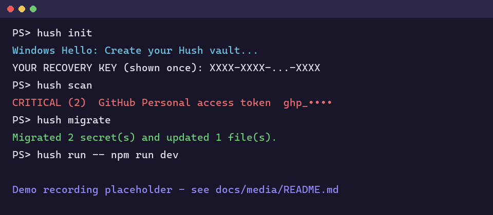
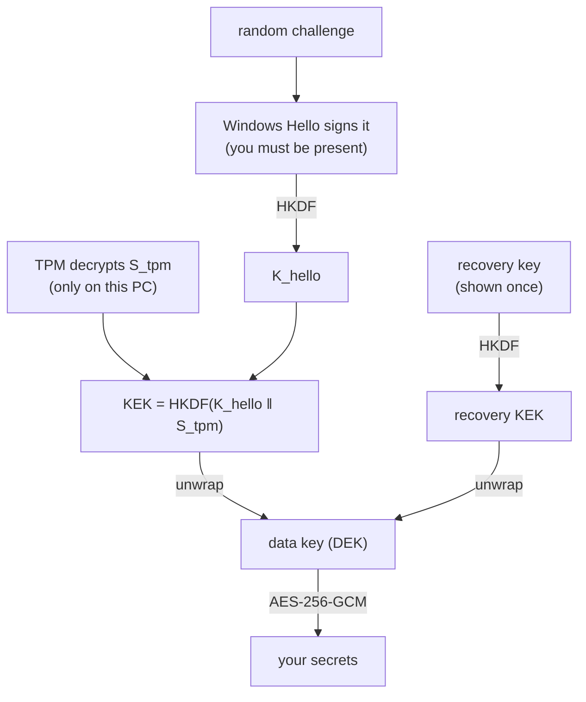

# Hush

**Secrets for developers and AI agents, locked to your PC's TPM and your face, fingerprint or PIN.**

[](https://github.com/ide-bloom/hush/actions/workflows/ci.yml)
[](https://github.com/ide-bloom/hush/releases)
[](LICENSE)



> The demo is a placeholder image until a recording is made; [docs/media/README.md](docs/media/README.md) has the
> recording script.

Hush moves API keys and tokens out of `.env` files, MCP configs and credential files into an encrypted vault that
only opens **on this machine** (TPM) **with you present** (Windows Hello). Secrets are injected as environment
variables into the one process that needs them and never touch disk in plaintext:

```powershell
hush run -- npm run dev
hush run -- claude
```

Hush is part of **Palisade**, a toolkit for developer security in the AI-agent era, with
[Epicurus](https://github.com/ide-bloom/epicurus) and [Rousseau](https://github.com/ide-bloom/rousseau).

## Why Hush exists

Developer machines are full of plaintext secrets: `.env` files, `.npmrc`, `.git-credentials`, cloud CLI profiles
and, more and more, MCP server configs with API keys pasted straight into JSON. Two things made that much worse
in 2026:

1. **AI coding agents run with your full permissions.** They can read `.env` files, SSH keys and tokens, and a single
   prompt injection in a README, an issue or a web page can tell them to send those files somewhere. Researchers
   have shown prompt injection driving credential theft in agentic editors
   ([“Your AI, My Shell”, arXiv 2509.22040](https://arxiv.org/abs/2509.22040)), and MCP credential storage has been
   plaintext-by-default from the start
   ([Trail of Bits, 2025](https://blog.trailofbits.com/2025/04/30/insecure-credential-storage-plagues-mcp/)).
2. **Infostealers now target exactly these files.** Gen Digital reports WardenStealer collecting AI-agent tokens
   and MCP configurations
   ([Gen Digital](https://www.gendigital.com/blog/insights/research/infostealers-your-ai-agent)), and the Aoki
   stealer goes after Claude Code, Codex, Cursor and Copilot credentials and `.env` files
   ([Infosecurity Magazine](https://www.infosecurity-magazine.com/news/aoki-infostealer-ai-coding/),
   [SpyCloud](https://spycloud.com/blog/infostealers-now-target-ai-tokens-and-api-keys/)).

Hush removes the plaintext. A copied vault is useless on another machine, malware running as you cannot unlock it
without you approving a Windows Hello prompt, and an agent that reads your config files finds no secrets.

## 60-second quick start

Requires Windows 11 with Windows Hello set up (PIN, face or fingerprint). A TPM is strongly recommended; without one
Hush runs in a clearly flagged degraded mode.

```powershell
# Download hush-<version>-win-x64.zip (or -win-arm64) from Releases, unzip it, and put the folder on PATH.

hush init                         # create the vault: approve Windows Hello 3 times, write down the recovery key
hush scan                         # find plaintext secrets (shown redacted: first 4 characters only)
hush migrate --dry-run            # preview: vault the secrets and rewrite configs, as a redacted diff
hush migrate                      # do it (originals are backed up; 'hush migrate --undo' restores them)
hush run -- npm run dev           # run with the project's secrets in the environment
```

Restart MCP clients after migrating; their servers now launch through `hush run`.

> **Keep your recovery key.** Resetting Windows Hello or clearing the TPM destroys the factors that unlock the vault.
> After that, the recovery key is the only way back in. Hush shows it once, at `hush init`.

## How it works



- The **Windows Hello** signature over a per-vault challenge is deterministic, so it can derive a key that only you,
  in person, on this PC, can produce. Hush checks that determinism at `hush init` and refuses to create the vault if
  signatures differ.
- **`S_tpm`** is sealed with a non-exportable RSA key in the TPM, which binds the vault to this machine.
- The **DEK** encrypts each secret with AES-256-GCM, a unique nonce and AAD tying it to its vault, entry and version.
  It is also wrapped under the **recovery key**.
- After an unlock, the **session broker** (`hush agent`) holds the DEK in memory so repeated `hush run` calls do not
  prompt. It locks after 10 idle minutes (configurable) and immediately when you lock Windows, switch users or put
  the PC to sleep. It serves only Hush's own binaries, checked by path, SHA-256 and signer, over a pipe only you can
  open.
- **`always-prompt`** secrets need a fresh Windows Hello confirmation on every use, even while unlocked.
- Every access is recorded in an **HMAC-chained audit log** with the requesting process and its parent.

Details: [crypto](docs/crypto.md), [vault format](docs/vault-format.md), [architecture](docs/architecture.md),
[threat model](docs/threat-model.md), [scanner rules](docs/scanner-rules.md).

## Commands

| Command | What it does |
|---|---|
| `hush init` | Create the vault, enroll Windows Hello and the TPM, show the recovery key once. |
| `hush init --project` | Create a `.hush.toml` manifest in the current directory. |
| `hush status [--json]` | Vault health, factors (TPM or degraded), lock state, timeout, number of secrets. |
| `hush unlock` / `hush lock` | Start or end the session. |
| `hush set NAME [--policy always-prompt] [--scope PROJECT]` | Store a secret, read from a hidden prompt (asked twice) or from stdin; never from the command line. |
| `hush get NAME --copy` | Copy to the clipboard, excluded from clipboard history and cloud sync, cleared after 30 s. |
| `hush get NAME --reveal` | Print the value, after a confirmation. |
| `hush list [--scope S] [--json]` | Names, scopes, policies, last used. Never values. |
| `hush rm NAME [--yes]` | Delete a secret. |
| `hush run [--secrets A,B] [--profile P] [--mask] -- CMD [ARGS]` | Run a command with secrets in its environment, stream its stdio, forward Ctrl+C, return its exit code. `--mask` replaces secret values in its output with `••••`. |
| `hush scan [PATHS] [--json \| --sarif] [-o FILE] [--no-defaults] [--exit-code]` | Find plaintext secrets, reported redacted. |
| `hush migrate [PATHS] [--dry-run] [--yes] [--undo [--force]]` | Move findings into the vault and rewrite configs to use Hush. |
| `hush audit [--verify] [-n N] [--filter TEXT]` | Show the audit log; `--verify` checks the hash chain. |
| `hush recover` | Restore access with the recovery key and enroll new Windows Hello and TPM factors. |
| `hush rotate` | Re-encrypt everything under a new key and issue a new recovery key. |
| `hush export --encrypted FILE` / `hush import FILE [--overwrite]` | Encrypted backup that opens with the recovery key, for moving to a new PC. |
| `hush config [KEY [VALUE]]` | `idle-timeout` (minutes), `lock-on-sleep`, `scan-roots` (`;`-separated). |
| `hush agent [--stop]` | Run (or stop) the session broker. Started automatically when needed. |
| `hush git-helper get` | Git credential helper serving vaulted credentials. |

Names may contain letters, digits, `_ . - @`. A secret is global (`NAME`) or belongs to a project scope
(`scope/NAME`, or `--scope`).

### `--secrets`

A comma-separated list of `NAME` (injected as the variable `NAME`) or `VAR=NAME` items. `NAME` can be `scope/NAME`, or
`/NAME` for an explicitly global secret. Inside a project with a `.hush.toml`, a bare `NAME` means the project's
secret, falling back to the global one.

## `.hush.toml`

Safe to commit: it holds names and mappings, never values. `hush run` looks for it in the current directory and its
parents.

```toml
version = 1
project = "shop"            # the scope for this project's secrets (defaults to the folder name)
default_profile = "dev"     # optional

[env]                       # ENV_VAR = "SECRET"
DATABASE_URL = "DATABASE_URL"       # shop/DATABASE_URL, falling back to the global DATABASE_URL
OPENAI_API_KEY = "/OPENAI_API_KEY"  # the global secret only
STRIPE_KEY = "payments/STRIPE_KEY"  # a secret in another scope

[profiles.staging.env]      # hush run --profile staging (or HUSH_PROFILE=staging)
DATABASE_URL = "DATABASE_URL.staging"
```

`hush migrate` writes this file for you when it migrates a project's `.env` files: `.env` and `.env.local` map to
`[env]`, and `.env.NAME` maps to profile `NAME`.

## MCP integration

`hush migrate` rewrites each stdio server with inline secrets in its `env` so that it launches through Hush. You can
also write these by hand. The pattern is the same everywhere: the command becomes `hush`, and the original command
moves after `run --secrets NAMES --`.

Rewritten configs use `hush` when the `hush.exe` on `PATH` is the one that ran the migration, and its full path
otherwise, because MCP clients start servers without a shell.

**Claude Desktop** (`%APPDATA%\Claude\claude_desktop_config.json`), **Cursor** (`~\.cursor\mcp.json`), **Windsurf**
(`~\.codeium\windsurf\mcp_config.json`) and **Gemini CLI** (`~\.gemini\settings.json`):

```json
{
  "mcpServers": {
    "github": {
      "command": "hush",
      "args": ["run", "--secrets", "GITHUB_PERSONAL_ACCESS_TOKEN", "--", "npx", "-y", "@modelcontextprotocol/server-github"]
    }
  }
}
```

**Claude Code**: user servers live in `~\.claude.json` (top level and per project), project servers in `.mcp.json`.
To add one:

```powershell
claude mcp add github -- hush run --secrets GITHUB_PERSONAL_ACCESS_TOKEN -- npx -y @modelcontextprotocol/server-github
```

**VS Code** (`%APPDATA%\Code\User\mcp.json` or `.vscode\mcp.json`; comments and trailing commas are preserved):

```jsonc
{
  "servers": {
    "github": {
      "type": "stdio",
      "command": "hush",
      "args": ["run", "--secrets", "GITHUB_PERSONAL_ACCESS_TOKEN", "--", "npx", "-y", "@modelcontextprotocol/server-github"]
    }
  }
}
```

**OpenAI Codex** (`~\.codex\config.toml`):

```toml
[mcp_servers.github]
command = "hush"
args = ["run", "--secrets", "GITHUB_PERSONAL_ACCESS_TOKEN", "--", "npx", "-y", "@modelcontextprotocol/server-github"]
```

If the vault is locked when a client starts a server, Hush raises the Windows Hello prompt with that client's window
as its owner, so it should appear in front of it (see the manual verification checklist in
[docs/architecture.md](docs/architecture.md#windows-hello-in-the-foreground)).

**Remote (HTTP) servers** with a credential in `headers` cannot be wrapped: Hush does not inject HTTP headers.
`hush migrate` leaves them alone and tells you to rotate the credential and use the client's OAuth sign-in or its
environment-variable expansion instead.

### Other credential files

- **`.npmrc`**: tokens are replaced with `${NPM_TOKEN}`, which npm expands from the environment. Run npm commands
  that need the registry with `hush run --secrets NPM_TOKEN -- npm publish`. npm reports an error when such a variable
  is unset.
- **`.pypirc`**: passwords are removed; twine reads `TWINE_PASSWORD`:
  `hush run --secrets TWINE_PASSWORD -- twine upload dist/*`.
- **`.git-credentials`**: credentials move to the vault (scope `git`, named `user@host`) and Hush becomes your Git
  credential helper:

  ```powershell
  git config --global --unset-all credential.helper store
  git config --global --add credential.helper "hush git-helper"
  ```

Git is the only one of these tools with a documented external credential-helper protocol, so it is the only one
where Hush acts as the helper. npm has no helper mechanism (it reads tokens from `.npmrc`, with `${VAR}` expansion),
and pip and twine use Python `keyring` backends, which are in-process Python plugins rather than external programs.
For those, Hush uses the documented environment-variable route shown above.

### Token files Hush cannot vault

Claude Code (`~\.claude\.credentials.json`), Codex (`auth.json`), Gemini CLI (`oauth_creds.json`), GitHub Copilot and
the gcloud SDK keep their own OAuth tokens in files. Hush cannot move them without breaking those tools. `hush scan`
lists them separately, with what each token grants and how to revoke or rotate it. They remain an infostealer target:
revoke them if a machine is ever compromised, and prefer short sessions.

## Tray app

`HushTray.exe` lives in the notification area. The icon shows whether the vault is locked; the menu has Unlock, Lock
and Open. The window, which follows the Windows light/dark theme, has four pages:

- **Vault**: names, scopes, policies and last use; add, edit and delete secrets. Revealing a value needs Windows Hello.
- **Scan**: run a scan, review findings by risk, preview the migration (redacted diff) and apply it, or undo the last one.
- **Audit log**: filter by action or text, and verify the chain.
- **Settings**: idle timeout, lock on sleep, scan roots, start with Windows.

The app uses the same broker and core library as the CLI. Closing the window keeps it in the tray; Exit is in the
tray menu.

## Threat model

**Hush protects against:**

- **Offline theft**: a stolen disk, a backup or a copied `vault.hush` cannot be opened without this PC's TPM and your
  Windows Hello, or the recovery key.
- **Silent user-level malware**: unlocking needs you to approve a Windows Hello prompt, and migrated files no longer
  contain secrets for stealers to sweep up.
- **Agents reading plaintext**: `.env` files and MCP configs hold stubs and `hush run` commands, not values.

**Hush does not protect against:**

- **Malware that waits for an unlocked session.** While unlocked, a process running as you can ask the broker for
  secrets through a real `hush.exe`. Mark important secrets `always-prompt`, keep the timeout short, lock Windows when
  you leave, and check `hush audit`.
- **Administrator or kernel compromise.**
- **Secrets after they are injected into a process.** The child process, anything it spawns, and other processes
  running as you can read them.

Full analysis: [docs/threat-model.md](docs/threat-model.md).

## FAQ

**What happens if I reset Windows Hello, clear the TPM or get a new PC?**
The vault's primary factors are gone. Run `hush recover` with your recovery key. On a new PC, either copy `vault.hush`
over and run `hush recover`, or run `hush export --encrypted backup.hushx` on the old PC and `hush init` then
`hush import backup.hushx` on the new one.

**I have no TPM.** Hush uses DPAPI instead and marks the vault as degraded everywhere. Windows Hello is still required,
but the vault is no longer bound to hardware.

**Does Hush send anything anywhere?** No. Hush makes no network connections.

**Why does `hush init` ask for Windows Hello three times?** Once to create the key, then twice to confirm that its
signatures are deterministic, which is what lets them derive a key.

**Can an AI agent use `hush run` to read my secrets?** If the vault is unlocked and the agent runs commands as you,
yes, the same way it could run your shell. That is why per-server injection, `always-prompt` for high-value secrets, a
short idle timeout and the audit log matter. Hush stops agents from *reading files* full of secrets; it does not
sandbox them.

**Where are my files?** `%LOCALAPPDATA%\Hush` (vault, audit log, settings, migration backups, logs). Set `HUSH_HOME` to
use another folder.

**Can I use it in CI?** `hush scan --sarif` and `--exit-code` work anywhere. The vault is designed for interactive
developer machines with Windows Hello, not for build agents.

## Building from source

```powershell
dotnet build Hush.sln -c Release
dotnet test --solution Hush.sln -c Release
./build/publish.ps1 -Runtimes win-x64        # artifacts\win-x64\hush.exe (Native AOT) and HushTray.exe
```

Requires the .NET 10 SDK. Native AOT also needs Visual Studio or the Build Tools with the C++ workload; use
`./build/publish.ps1 -NoAot` without them.

## Security

Report vulnerabilities privately; see [SECURITY.md](SECURITY.md). Releases include `SHA256SUMS` and build provenance
attestations (`gh attestation verify`).

## License

[MIT](LICENSE)
