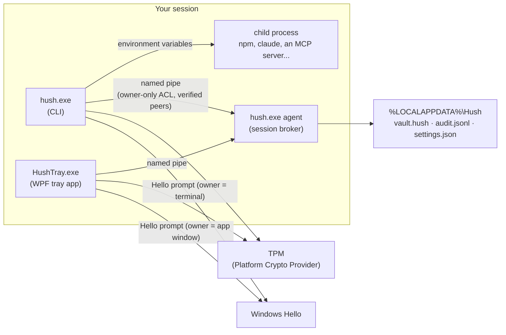

# Architecture

## Components

| Project | Output | Role |
|---|---|---|
| `src/Hush.Core` | library | Vault format and crypto, key providers (Hello, TPM, DPAPI), session client, broker protocol, scanner and rules, migrators, manifest, audit log, settings. Everything else is a thin layer over it. |
| `src/Hush.Agent` | library | The session broker: request handling (`BrokerService`), the pipe server (`BrokerServer`), session-lock monitoring and the idle timer. Hosted by `hush.exe agent`. |
| `src/Hush.Cli` | `hush.exe` | The command line (System.CommandLine), `hush run`'s process runner and output masking, the Git credential helper. |
| `src/Hush.App` | `HushTray.exe` | WPF tray app with the built-in Fluent theme. Uses `Hush.Core` and the broker; contains no vault or crypto logic. |
| `src/Hush.Analyzers` | analyzer | HUSH001: a `[Sensitive]` value passed to a logging call fails the build. |

The tray app is `HushTray.exe`, not `Hush.exe`, because both binaries ship in one folder and NTFS names are
case-insensitive: `hush.exe` and `Hush.exe` cannot coexist.

## Who holds what

- **Clients** (`hush.exe`, `HushTray.exe`) perform every Windows Hello prompt and every TPM decryption, in the process the
  user is looking at. After unlocking they hand the DEK to the broker and zero their copies.
- **The broker** holds the DEK in a pinned buffer, serves secrets to verified clients, performs every vault write
  while unlocked, and writes the audit log. It never shows UI.
- `hush init`, `hush recover` and `hush rotate` run their key ceremonies in the CLI (they need Hello and the TPM), write
  the vault directly under the writer lock, then hand the resulting DEK to the broker.
- `hush list`, `hush status` and `hush audit` (without `--verify`) read the vault and log directly. Names, policies and
  timestamps are stored unencrypted, so these work while locked.

The CLI starts the broker on demand (`hush agent`, hidden). It is started with ShellExecute rather than
CreateProcess with inherited handles, so that a long-lived broker never holds a short-lived client's stdout pipe open.
This matters when an MCP client is waiting for EOF.

## IPC

- **Name**: `\\.\pipe\hush-broker-<first 16 hex digits of SHA-256(user SID)>`.
- **ACL**: protected DACL with one allow entry (the current user: read, write, create instance) and an explicit deny
  for `NT AUTHORITY\NETWORK`. The owner is the current user.
- **Squatting**: the broker creates its first instance with `FILE_FLAG_FIRST_PIPE_INSTANCE`. If any other process
  already owns the name, the broker refuses to start instead of sharing it.
- **Client verification (broker side)**: for each connection the broker calls `GetNamedPipeClientProcessId`, reads
  the client's image path (`QueryFullProcessImageName`) and accepts it only if:
  1. it is in the broker's own install directory (after resolving symbolic links, which winget uses),
  2. its file name is `hush.exe` or `HushTray.exe`,
  3. its SHA-256 equals the hash recorded when the broker started, and
  4. when the broker binary is Authenticode-signed, it carries a valid signature from the same signer (`WinVerifyTrust`
     plus the signer certificate thumbprint).

  A rejected client receives a refusal and nothing else. A client built from a newer release is rejected by an older
  running broker (hash mismatch); the client then stops that broker (which it has verified to be this install's
  `hush.exe`) and starts a fresh one.
- **Server verification (client side)**: before sending anything, and unlock requests carry the DEK, the client opens
  the pipe with `PipeOptions.CurrentUserOnly`, calls `GetNamedPipeServerProcessId`, and applies the same checks to the
  server, which must be this install's `hush.exe`.
- **Framing**: one request per connection, a 4-byte little-endian length followed by UTF-8 JSON (source-generated
  `System.Text.Json`), at most 4 MiB. Frame buffers are zeroed after use.

## Session lifetime

The broker locks (zeroes the DEK) when:

- no request other than `status` has arrived for the idle timeout (default 10 minutes, 1 to 1440, set with
  `hush config idle-timeout <minutes>` or in the tray app; status polling does not keep a session alive),
- the workstation locks, the console session is disconnected or switched, a remote session disconnects, or the user
  logs off (`SystemEvents.SessionSwitch`, `SessionEnding`),
- the machine suspends, when "lock on sleep" is on (default; `SystemEvents.PowerModeChanged`),
- the user runs `hush lock` or uses the tray's Lock action,
- the vault file changes underneath it in a way its DEK cannot verify (after `hush rotate` elsewhere, for example).

`SystemEvents` creates its own hidden window on a dedicated thread when subscribed from a thread without a message
loop, which is the broker's situation.

## Windows Hello in the foreground

A Windows Hello prompt raised by a console program is easy to lose behind the terminal. Hush passes an owner window:

- On Windows 11 24H2 and later (build 26100+), Hush uses `KeyCredentialManager.RequestCreateForWindowAsync` and
  `KeyCredential.RequestSignForWindowAsync` with a `WindowId` built from the owner HWND. These APIs are documented for
  desktop apps that need to parent the credential dialog. Earlier builds use the windowless calls.
- The owner window (`PromptOwner.ForConsole`) is chosen in this order: the console window when it is a visible conhost
  window; otherwise the root owner of the console window, because Windows Terminal and VS Code host consoles through
  ConPTY, whose pseudo-console window is hidden but owned by the real terminal window; otherwise the foreground window,
  which is the terminal or IDE the command was typed into, or the app (an MCP client, for example) that launched Hush
  without a console.
- The tray app passes its main window, showing and activating it first if it was hidden in the tray.

**Manual verification checklist.** Run this on each release candidate, because CI machines have no Hello. Use a
scratch vault (`$env:HUSH_HOME = "$env:TEMP\hush-check"`), then run `hush init` and `hush unlock` from each host and
confirm that the Windows Security dialog appears in front of it and accepts input:

| Host | `hush init` | `hush unlock` | `hush run` launched by an MCP client |
|---|---|---|---|
| Windows Terminal (PowerShell) | | | n/a |
| VS Code integrated terminal | | | n/a |
| Classic console (conhost, `cmd.exe`) | | | n/a |
| Claude Desktop (stdio MCP server) | n/a | n/a | |

Also check by hand that Ctrl+C reaches the child: `hush run --secrets X -- ping -t 127.0.0.1` in each terminal,
press Ctrl+C, and confirm that ping prints its statistics and Hush exits with ping's exit code. Automating this needs
a process attached to a real console, which the test runner does not have.

## Target framework

The projects target `net10.0-windows10.0.26100.0` with `SupportedOSPlatformVersion` 10.0.22621.0. The design brief
suggested the 22621 TFM. However, `RequestCreateForWindowAsync` and `RequestSignForWindowAsync` exist only in the
26100 Windows SDK metadata, and even then only from projection package 10.0.26100.87, which is pinned with
`WindowsSdkPackageVersion` in `Directory.Build.props`. Every Windows release Hush supports (11 24H2, 25H2, 26H1) is
26100 or later, and calls to the newer APIs are guarded by `OperatingSystem.IsWindowsVersionAtLeast(10, 0, 26100)`, so
the binaries still run on 22621 with windowless prompts.

## Native AOT

`hush.exe` is published with Native AOT (`dotnet publish -r win-x64`; see `build/publish.ps1`). It was tried as the
brief asked, and it works:

- The ILCompiler reports no trimming or AOT warnings for the CLI, the broker and `Hush.Core`. JSON and TOML use
  source generators (System.Text.Json, Tomlyn), and P/Invoke uses `LibraryImport`.
- The C#/WinRT projection works under AOT. During development, an AOT build of the same projection activated
  `KeyCredentialManager`, awaited its async operations, and created, used and deleted a Platform Crypto Provider key
  (RSA-OAEP-SHA256) on a Windows 11 PC with a TPM.
- Startup is fast, which matters because MCP clients launch `hush run` for every server.

The fallback is still available: `./build/publish.ps1 -NoAot` (or `-p:HushAot=false`) produces a self-contained
single file with ReadyToRun. Native AOT needs the MSVC linker (Visual Studio or Build Tools with C++); GitHub's
`windows-latest` image includes the x64 and ARM64 toolsets used to build both architectures.

`HushTray.exe` is a self-contained single file with ReadyToRun. WPF does not support trimming, so it cannot use AOT.

## Files

| Path | Written by | Contents |
|---|---|---|
| `%LOCALAPPDATA%\Hush\vault.hush` | CLI ceremonies, broker | the vault ([format](vault-format.md)) |
| `vault.lock` | any writer | exists only while a write is in progress |
| `audit.jsonl`, `audit.pending.jsonl` | broker, CLI | audit chain, pending events |
| `settings.json` | CLI `config`, tray app | idle timeout, lock on sleep, scan roots |
| `backups\<timestamp>\` | `hush migrate` | original files and `journal.json` for `--undo` |
| `logs\agent-YYYYMMDD.log` | broker | JSON-lines diagnostics; never secret values |

Set `HUSH_HOME` to use another folder (tests and portable setups). `HUSH_LOG_LEVEL` (`Debug`, `Information`...)
controls log verbosity, and `HUSH_PROFILE` selects a manifest profile for `hush run`.

## `hush run`

1. Resolve bindings from `--secrets` or the nearest `.hush.toml` (searched upward from the current directory).
2. Ask the broker for the values (unlocking with Hello if needed; always-prompt secrets add a presence proof). The read
   is audited with the program name and the requesting process and its parent.
3. Resolve the program the way a shell would (PATH plus PATHEXT, so `npm` finds `npm.cmd`), start it with the
   variables added to a copy of Hush's environment, and place it in a kill-on-close job object so it cannot outlive
   Hush.
4. Without `--mask`, the child inherits the console handles directly, so TUIs and stdio MCP servers behave as if run
   without Hush. With `--mask`, stdout and stderr are piped through a streaming filter that replaces secret values
   (4 characters or longer) with `••••`, including values split across writes.
5. Ctrl+C reaches the child through the shared console; Hush ignores it and waits. Hush exits with the child's exit
   code.

## Testing

- `tests/Hush.Core.Tests`: vault round trips, tamper detection, nonce uniqueness, recovery, rotation, crash-safe writes,
  the audit chain, scanner rules against generated fixtures, migrator golden files for every MCP client format,
  manifest resolution, and the HUSH001 analyzer.
- `tests/Hush.Cli.Tests`: `hush run` with real child processes (environment injection, exit codes, masking), the broker
  (locking, idle timeout, presence proofs, a real named-pipe round trip with the ACL, first-instance protection and
  peer rejection), peer-verification rules, and end-to-end CLI flows through an in-process broker.
- `tests/Hush.App.Tests`: the tray app's Vault page data model, including picking up secrets that another process
  (the CLI) adds while the app is running.
- All tests use `TestKeyProvider` (software Hello and TPM stand-ins). Production builds refuse it: one test runs the
  real `hush.exe` against a test-provider vault and checks that it is rejected.
- Not covered by automated tests: real Windows Hello prompts and their placement (see the manual checklist above),
  Ctrl+C delivery through a console, `SystemEvents` delivery of lock and sleep notifications (the mapping from
  event to lock reason is tested), and the tray app's XAML views, which are a thin layer over the tested model, Core and broker.
