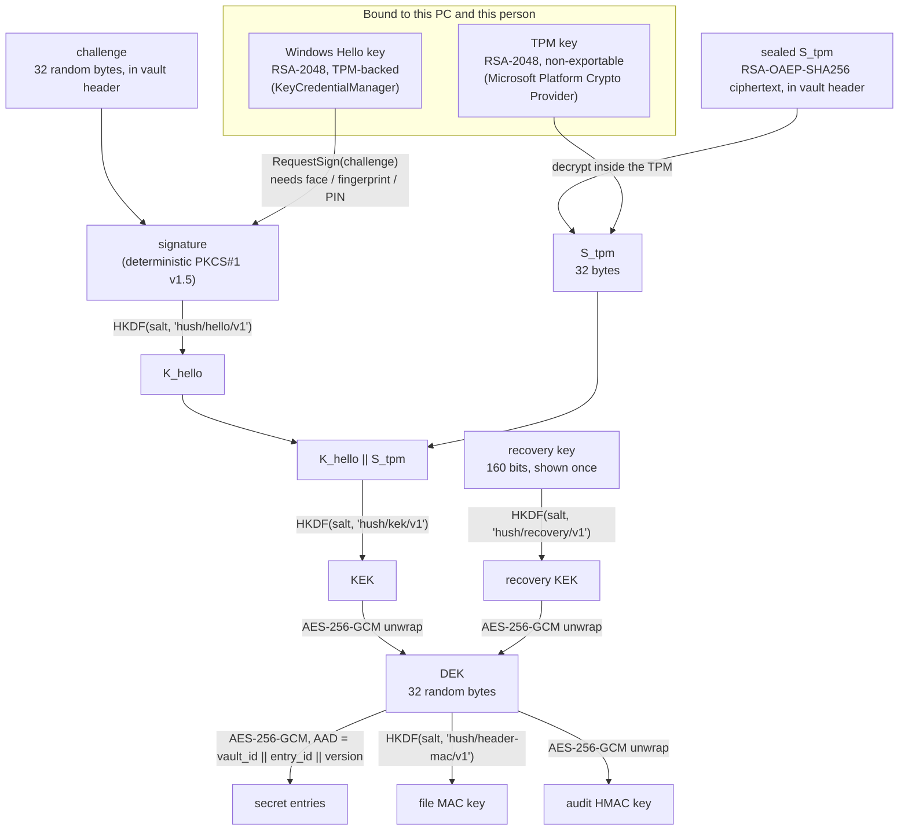
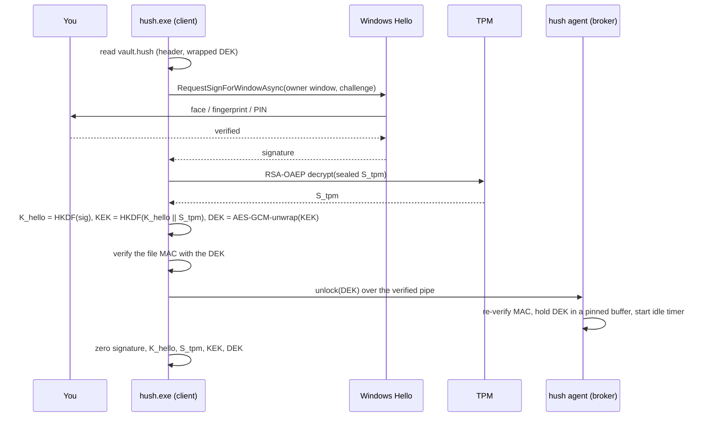

# Cryptographic design

This document describes exactly what Hush does with keys. The code lives in `src/Hush.Core/Crypto`,
`src/Hush.Core/Keys` and `src/Hush.Core/Vault`; the on-disk layout is in [vault-format.md](vault-format.md).

All primitives come from `System.Security.Cryptography` (Windows CNG underneath): AES-256-GCM, HKDF-SHA256,
HMAC-SHA256, SHA-256, RSA-OAEP-SHA256 and RSASSA-PKCS1-v1_5. Hush implements no cryptographic primitive itself.

## Key hierarchy

| Key | Size | Where it lives | Derivation |
|---|---|---|---|
| Windows Hello key | RSA-2048 | Windows Hello container (TPM when present) | `KeyCredentialManager.RequestCreateAsync` / `RequestCreateForWindowAsync` |
| `K_hello` | 32 bytes | memory only | `HKDF-SHA256(ikm = Hello signature over challenge, salt = vault salt, info = "hush/hello/v1")` |
| TPM key | RSA-2048 | Microsoft Platform Crypto Provider, non-exportable | `CngKey.Create` with export policy *none* |
| `S_tpm` | 32 bytes | sealed in the vault header | random; sealed with RSA-OAEP-SHA256 under the TPM key |
| KEK | 32 bytes | memory only | `HKDF-SHA256(ikm = K_hello ‖ S_tpm, salt, info = "hush/kek/v1")` |
| Recovery key | 160 bits | the user's notes | random; displayed once |
| Recovery KEK | 32 bytes | memory only | `HKDF-SHA256(ikm = recovery key, salt, info = "hush/recovery/v1")` |
| DEK | 32 bytes | wrapped twice in the header; in memory while unlocked | random |
| File MAC key | 32 bytes | memory only | `HKDF-SHA256(ikm = DEK, salt, info = "hush/header-mac/v1")` |
| Audit key | 32 bytes | wrapped under the DEK in the header | at creation, `HKDF-SHA256(ikm = DEK, salt, info = "hush/audit/v1")`; kept stable across DEK rotation |

The vault salt is 32 random bytes generated at `hush init`. It salts every HKDF in the vault, including the recovery
derivation: the design brief specified `HKDF(recovery_key, info = "hush/recovery/v1")`, and Hush adds the per-vault
salt so the same recovery key bytes could never produce the same wrapping key for two vaults.

## Why a Windows Hello signature can be a key

Windows Hello does not give applications a symmetric key. It can only *sign* with a key that the user unlocks with
their face, fingerprint or PIN. Hush signs a fixed, random, per-vault challenge. With RSASSA-PKCS1-v1_5 the signature
over a fixed message is deterministic, so it is a stable secret that can only be produced on this PC, by this user,
in person. `K_hello` is derived from it with HKDF.

Microsoft's documentation does not promise a padding scheme for `KeyCredential.RequestSignAsync`, and a randomized
scheme (PSS) would make the signature useless as a key. So at `hush init` Hush signs the challenge **twice** and
compares the results in constant time. If they differ, `hush init` stops with *"Windows Hello produced two different
signatures"*, deletes the Hello key and writes nothing. This is why `hush init` asks for three verifications: one to
create the key and two signatures.

The Hello public key (SubjectPublicKeyInfo DER) is stored in the vault header. It is not needed for unlocking, but the
broker uses it to verify presence proofs for always-prompt secrets (below).

## Why two factors

| An attacker who has... | Hello factor | TPM factor | Result |
|---|---|---|---|
| a copy of `vault.hush` on another PC | missing (no Hello key) | missing (no TPM key) | cannot unlock; only the recovery key helps |
| code running as you, with no one at the keyboard | needs a Hello prompt the user must approve | available | cannot unlock silently |
| your Windows Hello (for example a shoulder-surfed PIN) on another PC | Hello keys do not leave the PC | missing | cannot unlock |

The KEK needs both. `K_hello` binds unlocking to *presence*; `S_tpm` binds it to *this machine's TPM*. A Windows Hello
key is itself TPM-backed when a TPM exists, so the TPM factor mainly adds defense in depth and a binding that does not
depend on Hello's internals.

## Unlock

The Hello prompt happens in the client process, the one the user is looking at, with the terminal or app window as
its owner. The broker never shows UI. See [architecture.md](architecture.md#windows-hello-in-the-foreground).

## Entries

Each secret is encrypted with AES-256-GCM under the DEK:

- a fresh random 96-bit nonce for every encryption (including re-encryption on update and rotation),
- AAD = `vault_id (16) ‖ entry_id (16) ‖ entry_version (u32, little-endian)`.

The AAD binds a ciphertext to its vault, its entry and its version, so ciphertexts cannot be moved between entries
or replayed from an older version. Names, scopes, policies and timestamps are not encrypted (so `hush list` works while
locked); they are authenticated by the file MAC.

Nonce collisions: every vault operation draws nonces from the OS CSPRNG. With 96-bit random nonces the collision
probability stays negligible far beyond the number of encryptions a personal vault will ever perform (NIST SP 800-38D
recommends at most 2^32 random-nonce encryptions per key; a vault performs a few per change). Rotation (below) starts a
new key.

## File MAC

The last 32 bytes of `vault.hush` are HMAC-SHA256 over everything before them, keyed by
`HKDF(DEK, salt, "hush/header-mac/v1")`. It authenticates the header, the factor metadata, both wrapped DEKs, the
entry table and the audit head. It can only be checked once the DEK is known, so an unlocked client and the broker
verify it on every read, and every write recomputes it.

## Recovery

At `hush init` Hush generates a 160-bit recovery key and shows it once as nine groups of four Crockford Base32
characters: eight groups encode the 160 bits, and the ninth is a checksum (the first 20 bits of
`SHA-256("hush/recovery-checksum/v1" ‖ key)`). Crockford's alphabet has no I, L, O or U, and parsing maps I/L to 1 and
O to 0, so keys survive handwriting. The checksum catches typos before any cryptography runs.

The DEK is wrapped a second time under the recovery KEK. `hush recover`:

1. opens the DEK with the recovery key and verifies the file MAC,
2. enrolls a new Hello key and a new TPM key (generation + 1) and seals a new `S_tpm`,
3. re-wraps the DEK under the new KEK, keeping the recovery wrapping (the recovery key stays valid),
4. deletes the previous generation's Hello and TPM keys.

**Resetting Windows Hello or clearing the TPM destroys the primary factors. After that, the recovery key is the only
way back in.**

## Degraded mode (no TPM)

If the Microsoft Platform Crypto Provider cannot be opened, or the TPM fails the creation self-test (some TPMs
reject OAEP-SHA256), `S_tpm` is protected with DPAPI in the current-user scope instead (entropy
`"hush/dpapi/v1/" + key name`). The vault's `Degraded` flag is set and every surface says so: the CLI warning on each
command, `hush status`, the tray tooltip and the app banner. Windows Hello is still required to unlock, but DPAPI is
tied to the Windows account, not to hardware: someone with a copy of the vault and your account's credentials (or
DPAPI master keys) can derive `S_tpm`.

## Broker handover and presence proofs

The broker receives the DEK from a client that unlocked with Hello, over a named pipe whose ACL admits only the current
user and whose peer the client verifies before sending anything (see [architecture.md](architecture.md#ipc)).

For `always-prompt` secrets, being unlocked is not enough. The flow is:

1. the client asks the broker for a challenge; the broker returns 32 random bytes valid once, for two minutes,
2. the client signs them with the vault's Windows Hello key (a fresh prompt),
3. the broker verifies the signature against the Hello public key in the vault header (PKCS#1 v1.5 or PSS with
   SHA-256), consumes the nonce, and only then decrypts the secret.

A process that can talk to the broker but cannot get the user to approve a Hello prompt cannot read always-prompt
secrets, and a captured proof cannot be replayed.

## Rotation

`hush rotate` needs a fresh unlock (to get the KEK). It generates a new DEK, re-encrypts every entry (new nonces,
version + 1), re-wraps the audit key, wraps the new DEK under the KEK and under a **new** recovery key, and writes the
vault atomically. The old recovery key stops working. Exports made earlier still open with the old recovery key,
because an export carries its own copy of the recovery-wrapped DEK.

## Exports

`hush export --encrypted FILE` writes the same format with the `Portable` flag, without the hardware factor block and
with only the recovery wrapping. It opens with the recovery key on any PC and with nothing else. `hush import` decrypts
it with the recovery key and re-encrypts each secret under the local vault's DEK.

## Audit chain

Each audit line carries `prev` (the previous line's MAC) and `mac` = HMAC-SHA256(audit key, the line without its
`mac` field). The vault header stores the sequence number and MAC of the last entry, so editing a line breaks its MAC,
deleting one breaks the chain, and truncating the tail no longer matches the head in the vault. Events that happen
while no key is available (a cancelled unlock, for example) go to an unauthenticated pending file and are appended to
the chain, marked `deferred`, at the next unlock.

An operation appends its audit line and then writes the vault. If the process dies between the two, the log holds a
MAC-valid entry one step past the head recorded in the vault. `hush audit --verify` reports that as a warning, and the
next write chains from that entry and adds an `audit.interrupted` entry stating that the operation it records may not
have completed. The chain is never forked or rewritten.

The audit key is derived from the first DEK and then stored wrapped under the current DEK, so rotating the DEK does
not invalidate the history.

## Memory hygiene

- Key material lives in `SecureBuffer`: arrays on the pinned object heap (never moved or copied by the GC) that are
  wiped with `CryptographicOperations.ZeroMemory` on dispose. Intermediate arrays (signatures, decrypted factors,
  pipe frames) are zeroed as soon as they are used.
- Secret values become .NET strings at the edges where the platform demands strings: process environment blocks,
  the clipboard, JSON over the pipe. Strings cannot be wiped; this is a documented limit
  (see [threat-model.md](threat-model.md)).
- Secrets never appear in logs or exception messages. Types that carry them are marked `[Sensitive]`, and the
  HUSH001 analyzer fails the build if one reaches a logging call.

## Test provider

All hardware access goes through `IHardwareKeyProvider`. The test suite uses a deterministic software
implementation. Production code accepts a test provider, and opens a vault created by one (flag `TestProvider`), only
when the process's entry assembly carries `[HushTestHost]`, which only the test projects do.
